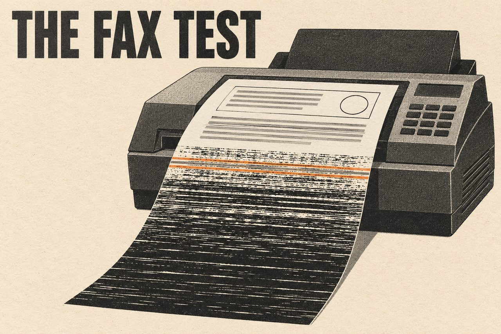

# The Fax Test



Can a language model write a complete TIFF decoder, fax compression included, in one answer? The Fax Test asks a
model once, through any OpenAI-compatible API, runs the code it writes on 40 TIFF files in a sandbox, and counts a
file only if every pixel is right.

The idea comes from [a post by u/DrkWzrd on r/huggingface](https://www.reddit.com/r/huggingface/comments/1y3naa1/silly_thought_the_best_benchmark_to_an_actual/)
arguing that a one-shot TIFF implementation is a good test of a frontier model, and that models go wrong writing out
the CCITT Group 3 and Group 4 code tables.

A fax machine scans a page into black and white dots and codes it by the
[fax standards](https://www.loc.gov/preservation/digital/formats/fdd/fdd000136.shtml) of the CCITT, today's ITU-T.
Group 3, from 1980, writes each line as runs of white and black and gives each run a
[code of variable length](https://en.wikipedia.org/wiki/Modified_Huffman_coding); Group 4, from 1984, also uses how
alike each line is to the one above. TIFF, the *Tagged Image File Format* from Aldus and Microsoft
([version 6.0 in 1992](https://www.loc.gov/preservation/digital/formats/fdd/fdd000022.shtml)), describes an image in
numbered tags and can hold the page in those same codes. Fax software stored pages this way for years before
[RFC 2306](https://www.rfc-editor.org/rfc/rfc2306) wrote the practice down in 1998 as TIFF-F, or "TIFF Class F".
Group 4 TIFF also became a [master format](https://www.loc.gov/preservation/digital/formats/fdd/fdd000024.shtml) for
scanned pages in digital libraries and document-management systems. Fax is still in daily use: in 2025, 40% of US
hospitals often sent patient records to other providers by mail or fax, and 81% received them that way at least
sometimes ([ONC, from the American Hospital Association's IT Survey](https://healthit.gov/data/quickstats/methods-used-hospitals-engage-interoperable-exchange/)).
Decoding these codes is old, exact and thoroughly documented work, so it tests whether a model can reproduce such
work rather than approximate it.

## Run it

With a model served locally by [Ollama](https://ollama.com), started with room for a long answer (Ollama's
[documentation](https://docs.ollama.com/faq) gives 4,096 tokens as its default context window, too small for the
prompt and a decoder):

```bash
OLLAMA_CONTEXT_LENGTH=65536 ollama serve
```

Then, in another terminal, with any model you have pulled:

```bash
git clone https://github.com/blixild-jacek/fax-test && cd fax-test && python3 faxtest.py run --base-url http://localhost:11434/v1 --model qwen3:32b --max-tokens 60000
```

That is the whole setup: Python 3.10 or newer and its standard library, nothing else to install. (On macOS,
`/usr/bin/python3` is Apple's 3.9, which the tool refuses; install Python from [python.org](https://www.python.org/downloads/),
Homebrew or uv.) On macOS the sandbox is
built in; on Linux and Windows the grader needs [Docker](https://docs.docker.com/get-docker/) running (see "The
sandbox" below). In Windows PowerShell, run the three commands one at a time (`git clone ...`, `cd fax-test`,
`python faxtest.py run ...`). While the model writes, the run prints how much it has written every 30 seconds; a
reasoning model can take many minutes.

Any server that speaks the OpenAI chat API works. Point `--base-url` at it and name the model as that server does:

| Server | `--base-url` (its default address) |
| --- | --- |
| [Ollama](https://ollama.com) | `http://localhost:11434/v1` |
| [llama.cpp](https://github.com/ggml-org/llama.cpp) `llama-server` | `http://localhost:8080/v1` |
| [vLLM](https://docs.vllm.ai) | `http://localhost:8000/v1` |
| [LM Studio](https://lmstudio.ai) | `http://localhost:1234/v1` |
| A hosted API | its base URL, with the key in `OPENAI_API_KEY` |

`OPENAI_BASE_URL` in the environment can stand in for `--base-url`. The key, if the server needs one, is read from
`OPENAI_API_KEY` (or the variable `--api-key-env` names). It is sent only to that server: the model's code never sees
your environment, and the key is not written to the results. An API that rejects the `max_tokens` field wants
`--max-tokens 0` and its own field in `--extra`; one that rejects `stream_options` wants
`--extra '{"stream_options": null}'`. A server that answers without streaming works too.

A run prints each file's result and ends with a line like this one (Qwen3.8-27B with reasoning off and `--turns 1`,
from a fresh clone, 25 November 2026):

```
The Fax Test, qwen3.8-27b: 9/40 files at best, CCITT 0/19; files by turn [7, 9]; saved results/qwen3.8-27b-20261125-152628.json
```

### Options worth knowing

1. **`--max-tokens N`** (default 32768): output tokens per request, reasoning included. A model that reasons before
   it answers can spend all of them thinking and never write the code; in our runs Qwen3.8-27B used over 100,000. The
   run says so when the limit ended an answer before any code. The server's context window has to hold the prompt
   (about 600 tokens) and this many more.
2. **`--turns N`**: after the first answer, the model is told which files passed and, for each failed one, its TIFF
   settings and what went wrong (never the file or its pixels), and writes the whole module again, up to N times.
   The first answer's score is the one-shot score.
3. **`--extra JSON`**: more request fields, sent as given, such as a model card's sampling or a server's switches;
   for example `--extra '{"top_p": 0.95, "chat_template_kwargs": {"enable_thinking": false}}'` turns reasoning off
   for Qwen3 models on vLLM. `--temperature T` is a shortcut for one of them.
4. **`--context N`**: the model's tokens per request. Each request's `--max-tokens` then shrinks to fit what the
   conversation already holds.

To grade a module written anywhere else, such as an answer copied from a chat app into a file:

```bash
python3 faxtest.py grade my_decoder.py
```

`python3 faxtest.py table` lists your saved runs.

To see what a decoder returned, file by file beside the original (needs Pillow):

```bash
python3 tools/gallery.py results/RUN.json [another.json ...]
```

It writes `results/gallery.png`: one row per chosen test file (10 by default, `--files` picks them; `--tiff FILE`
draws your own TIFF files instead), the original first, then each run's best module, every tile
marked exact, the share of pixels right, a short output or the error.

## What the test asks and checks

The request is [prompt.md](prompt.md), sent as the only message: one Python module, standard library only, with
`decode(data: bytes) -> (width, height, channels, pixels)`, which returns 8-bit samples (bilevel images as 0 and 255,
palettes expanded to RGB). It lists what the decoder must handle and says nothing about how.

The 40 files in [corpus/](corpus) cover:

| Compression | Files | What varies |
| --- | --- | --- |
| None | 9 | both byte orders, strips and 32x32 tiles, planar RGB, 1-, 4- and 8-bit, gray, RGB and palette |
| PackBits | 3 | bilevel, gray, RGB in big-endian order |
| LZW | 6 | with and without Predictor 2, several strips, a palette image |
| Deflate (8 and 32946) | 3 | with and without Predictor 2, the old code 32946 |
| CCITT modified Huffman (2) | 3 | FillOrder 2, a 3,000-pixel-wide page |
| CCITT Group 3, 1-D (3) | 5 | EOL fill bits, FillOrder 2, widths of 37, 1,728 and 3,000 pixels |
| CCITT Group 3, 2-D (3) | 4 | fill bits with several strips |
| CCITT Group 4 (4) | 7 | several strips, FillOrder 2, BlackIsZero, 256x256 tiles |

The images are drawn from fixed seeds: a 1,728-pixel-wide page of text, rules, a dithered gradient, noise and
one-pixel stripes; a page 37 pixels wide; one 3,000 pixels wide with runs over 2,560 pixels; gray and color images
of gradients and noise; and palette images. [libtiff](https://libtiff.gitlab.io/libtiff/) wrote every file (its
`tiffcp` tool, and Pillow's libtiff writer for the three CCITT modified Huffman files, which `tiffcp` cannot write),
and each was read back with libtiff and matched the drawing before it went in.
[tools/make_corpus.py](tools/make_corpus.py) builds them again, byte for byte with Pillow 12.3 (libtiff 4.7.1) and
tiffcp 4.7.2; it needs Pillow, numpy and tiffcp, and the test itself does not.

The module runs once per file, in a new process, with limits of 60 seconds, 1 GB of memory (measured by the grader
from outside the sandbox on macOS, set by Docker in a container) and 256 MB written in all (counted by the system on
macOS, the folder's size in Docker), 64 MB per file. A file counts only if every sample matches; the results file keeps, for each other file, the error, the wrong
size, or the share of pixels that were right.

## The sandbox

The code a model writes runs on your machine, so the grader confines it:

- **macOS:** `sandbox-exec`, which ships with the system, with a profile that denies everything it does not allow.
  The module may start only the Python interpreter, read only the system's libraries, Python's standard library and
  its native libraries and its own temporary folder, see file details only along those paths, and write only to
  that folder: no network, no other program or child process, no system services or system information, no other
  process's details, none of your files or their names, no `ctypes` (the prompt forbids it, and it reaches past
  such rules) and no installed third-party package. It gets only a `PATH`, nothing else of
  your environment. The code runs on your Python, while the prompt asks for 3.12; with an older Python the run says
  so. Checked with conda's Python 3.13 and Homebrew's Python 3.15 on macOS 26.
- **Linux and Windows:** Docker: each file in a new `python:3.12-alpine` container with no network, a read-only file
  system, 1 GB of memory and no swap, one CPU, at most 64 processes, every capability dropped and a time limit
  inside the container. None of your files is visible in it except the module's own folder, and the grader never
  follows a link or opens a pipe the module leaves there. The image is pulled once; an interrupted run stops its
  containers. Checked with Docker 29.5 (Colima) on macOS, which runs the same Linux containers.
- **`--sandbox none`** runs the code unconfined, with your rights. Use it only for code you have read.

`python3 faxtest.py selftest` checks the grader on decoders whose scores are known before they run (libtiff through
Pillow, if Pillow is installed for this Python, must pass all 40; the same with one sample changed must pass none; a
blank answer none; a 40-line partial decoder exactly its 6 files). Then a module tries, from inside the sandbox, to
read a file in this folder or see its details, connect to a listener the selftest opens on your machine, start a
child process or another program, write outside its folder, read `/etc/hosts`, import an installed package and read
the grader's own environment and load `ctypes`; under macOS every attempt must fail. Inside a Docker container,
processes, the container's own `/etc/hosts` and `ctypes` are allowed, since they reach nothing of yours, and your
files are not there to read.

## Our results

Measured on 25 November 2026 through our own API, the models running on our graphics cards, each at the sampling
its model card recommends (Arete-27B at the server's default). One to five runs per setting, so these show how the
models behave, not a score. Most ran on this test before it was packaged here, with the same prompt, files and
scoring; the sandbox and the reading of answers were tightened afterwards. The last three reasoning-off runs ran from
this repository.

| Model, setting | Requests (all turns) | Answers with code | Best answer, files right | CCITT files right |
| --- | --- | --- | --- | --- |
| Qwen3.8-27B, reasoning (60,000 and 261,000 tokens) | 6 | 4 | 12 of 40 | 0 of 19 |
| Qwen3.8-27B, reasoning off | 9 | 9 | 9 of 40 | 0 of 19 |
| Arete-27B (60,000 tokens) | 4 | 1 | 0 of 40 | 0 of 19 |
| Inkling 2 Mini (60,000 tokens) | 5 | 2 | 0 of 40 | 0 of 19 |
| Ternary Bonsai 2.5 27B (60,000 tokens) | 4 | 0 | 0 of 40 | 0 of 19 |

No answer decoded a single CCITT file. Qwen3.8-27B's best module read 12 files, all uncompressed, PackBits or
Deflate. At 60,000 tokens most answers from the reasoning models ended while still reasoning, with no code. Told
what had failed, Qwen3.8-27B with reasoning off went from 1 file to 8 in one turn and stayed there in one run, and from
7 to 9 in another; with reasoning, its module got worse each turn (6, 5, 1).


The illustration at the top of this page, saved as TIFF in six compressions, went through libtiff and through the
three best decoders, all written by Qwen3.8-27B. The color versions use Deflate, PackBits, no compression and LZW; the
black-and-white ones use the Group 3 and Group 4 fax codes. Deflate comes back exact from all three decoders, while
the fax versions and LZW come back almost all black or not at all. `tools/gallery.py --tiff` drew the figure, with
the decoders in the sandbox.

## What it does not test

One format, in Python, and the first image of each file. It leaves out JPEG inside TIFF, multi-page files, BigTIFF,
16-bit samples and how fast the code runs. It is one task, so it shows how a model handles exact, table-driven code,
not how good it is at coding in general.

## Privacy

The prompt and your feedback turns go only to the API you name. The answers, the reasoning, the grades and the
modules are saved in `results/` on your machine, after every turn; nothing is sent anywhere else. The selftest's
connection check uses a listener on your own machine.

## Status and licence

An example to adapt, not a maintained product. The picture at the top is an illustration, made with an image
model. MIT licence, see [LICENSE](LICENSE). Copyright (c) 2026 Jacek Garbuliński Blixild,
[blixild.com](https://blixild.com).
